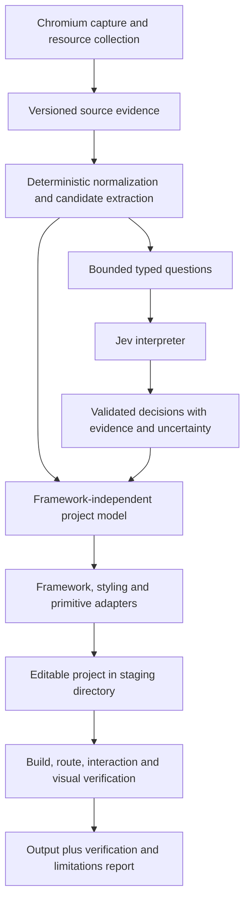

# Source reconstruction: decision map

Implementation progress (2026-11-08): the first bounded initial-state source-evidence
contract is implemented in the development checkout, including viewport manifests,
screenshots, offline validation, and an explicit projection to legacy analysis. A deterministic
project-model stage is also implemented locally; see [its contract](../PROJECT_MODEL.md).
Richer theme/interaction capture, source emission, and Jev integration remain subsequent work.
The proposal below is the roadmap; implemented scope is documented in README.

Status: proposed implementation plan, 2026-11-08. This document maps the decisions before
exporter implementation. Recommendations below are not claims of implemented support.
The user's established requirement is an editable source project. The next milestone is
one complete TanStack Start exporter, followed by other framework adapters.

Jev is identified as TypeSafe AI's System One model. Recommended role: the initial
semantic decision engine, behind a replaceable interpreter interface. It will select
among typed alternatives; Rust will construct and validate the project and emit source.
No live TypeSafe requests, model evaluation, source export, merge, or release was performed
while preparing this plan. API access and behavior on Mochi's fixtures remain unverified.

## Requirements and current boundary

- Preserve page content, assets, typography, layouts, literal routes, and observed behavior
  in editable files with useful shared components.
- Respect each target framework's routing and lifecycle conventions; create useful
  directories rather than empty `ui/`, `hooks/`, or monorepo scaffolding.
- Keep mirror output and existing clone/analyze callers working independently of export.
- Distinguish observations, algorithmic deductions, model proposals, and verified output.
- Do not claim the original repository, hooks, backend, or source component tree was recovered.

Current code supplies a useful index, not complete reconstruction evidence:
`src/capture.js` clips text at 512 UTF-16 code units, records twelve computed style
properties, and omits stylesheet rules, pseudo-elements, shadow roots, and iframe internals.
`src/analysis.rs` groups exact normalized structures and ranks repeated subtrees.
`src/cache.rs` and `src/mirror.rs` provide public asset revalidation and bounded downloads.
Full source export requires richer evidence; a model cannot recover omitted facts reliably.

## Pipeline



Jev is optional for mechanical export. An unresolved decision retains the original
structure and neutral names; it never silently becomes an invented fact.

## Decision ledger

`Direction` records the requested outcome. `Recommended` is the concrete implementation
default proposed here. `Deferred` is explicitly outside the first milestone. `Open`
names a remaining prerequisite rather than implying approval or completed verification.

| ID | Area | Decision | Status / main trade-off |
| --- | --- | --- | --- |
| D01 | Output | Generate a new editable project, with a separate mirror retained as evidence. | Direction; no claim of original-source recovery. |
| D02 | First target | TanStack Start, React, TypeScript, native file routes; qualify one pinned version tuple. | Recommended; one complete target before broad coverage. |
| D03 | Other targets | Reuse the project model for Astro, then SvelteKit; keep Next.js as another future adapter. | Deferred; each needs its own runtime and routing fixtures. |
| D04 | Host architecture | Keep the Rust CLI; built-in modules and explicit interfaces, no new service or database. | Recommended; JavaScript tooling is needed only to build/check exported projects. |
| D05 | Evidence | Add a richer, versioned source-capture artifact; preserve legacy analysis snapshots. | Recommended; requires recapture for faithful export from old clones. |
| D06 | Document content | Preserve full ordered text/element nodes, namespaces, attributes, metadata, form defaults, and asset references within declared bounds. | Recommended; clipping cannot count as complete evidence. |
| D07 | Styles | Capture applicable stylesheet rules, cascade context, variables, conditions, selected computed values, and pseudo-elements. | Recommended; preserve unsupported CSS explicitly rather than approximate it silently. |
| D08 | Responsive/theme states | Begin with configurable 375, 768, and 1440 px capture profiles; record actual theme/state coverage. | Recommended; sampled widths do not prove all breakpoints. |
| D09 | Interaction capture | Observe a narrow declared set of local UI transitions; no arbitrary submissions or inferred backend actions. | Recommended; invisible behavior remains an integration requirement. |
| D10 | Intermediate model | Versioned routes, layouts, components, props, style/token records, assets, behaviors, and evidence references. | Recommended; adapters consume the same validated model. |
| D11 | Reuse algorithm | Exact hashes first; align occurrences to extract varying content slots; prevent overlapping extractions. | Recommended; approximate structural matching follows later. |
| D12 | Props | Deduce text/image/link/value differences from aligned occurrences before asking a model to classify their roles. | Recommended; keep unaligned subtrees separate. |
| D13 | Routes | Preserve literal paths and queries; generate parameterized routes only from explicit mappings or confirmed evidence. | Recommended; URL similarity alone is insufficient. |
| D14 | Shared layouts | Extract a shared shell only when the route set and structural boundary support it. | Recommended; route nesting is not inferred from a URL prefix alone. |
| D15 | Model | Use pinned `jev-1.14.0` for the first TypeSafe integration, subject to actual API/fixture qualification. | Recommended; no moving `latest` alias in reproducible runs. |
| D16 | Model role | Typed semantic labels, applicability checks, compatibility judgments, and rankings. | Recommended; no free-form source, text, paths, or dependency generation. |
| D17 | Vision | Keep Jev images/Box disabled by default; evaluate separately if useful. | Deferred experimental capability; DOM geometry remains primary. |
| D18 | Other LLMs | No second generative model is required for the first exporter. Retain an interpreter interface for future alternatives. | Recommended; arbitrary naming/reasoning remains limited. |
| D19 | Confidence | Preserve distributions and provider metadata; use domain-tested decision rules with abstention. | Open calibration; no universal confidence cutoff or correctness claim. |
| D20 | Model transport | Call TypeSafe's HTTP API directly from Rust, using typed request/response structures and existing HTTP infrastructure. | Recommended; no Python/JS subprocess bridge for interpretation. |
| D21 | Naming | Derive safe identifiers from selected semantic roles and observed labels, with stable collision suffixes and neutral fallbacks. | Recommended; Jev does not invent identifier strings. |
| D22 | CSS backend | Start with CSS variables, component CSS Modules, and a controlled global stylesheet. | Recommended; richer CSS support grows through fixtures. |
| D23 | Tailwind/StyleX | Separate styling adapters over the same style/token model; qualify StyleX next for React, then other combinations independently. | Deferred; availability upstream is not Mochi compatibility. |
| D24 | Primitives | Semantic HTML for content; project-owned Base UI wrappers for supported observed React controls. | Recommended; no automatic default shadcn theme. |
| D25 | Tokens | Preserve observable variables; group exact repeated values, retain raw values, and distinguish inferred names from captured tokens. | Recommended; no arbitrary rounding or theme invention. |
| D26 | Fonts/assets | Track font-face descriptors and asset hashes; localize available permitted assets, rewrite URLs, and report unresolved resources. | Recommended; do not silently substitute fonts. |
| D27 | Project layout | Thin native routes; shared layout/UI components; feature-local data/types/behavior; hooks only for real reusable React logic. | Recommended; no empty folders or default monorepo. |
| D28 | Existing repositories | New-project output first; adapting an existing repository requires a separate discovery and patch workflow. | Deferred; avoids overwriting established conventions. |
| D29 | Runtime scripts/data | Generate new framework runtime and fixture data; never execute copied original bundles or invent server integrations. | Recommended; mirror fidelity and source reconstruction are separate contracts. |
| D30 | Toolchain | Start with npm and a committed package lock; pin Node and framework/build dependencies after a clean scaffold passes. | Recommended; exact compatible pins remain a pre-emission technical check. |
| D31 | Replay/cache | Freeze evidence and interpretation inputs; cache decisions by full input/question/model/configuration digest within the project. | Recommended; fresh model calls need not be identical. |
| D32 | Budgets/failures | Explicit model enablement and request/token/cost/deadline limits; finite retries; no model call during ordinary clone/export replay. | Recommended; live access and run budget must be configured. |
| D33 | Output ownership | Export to a new directory through staging; refuse collisions and symlink escapes; do not overwrite edited projects on rerun. | Recommended; patching user edits is a later feature. |
| D34 | Validation | Install/check/build/run the generated artifact; verify routes, data/props, responsive styles, focus/keyboard behavior, and renders. | Direction; generated folders or successful model responses are insufficient. |
| D35 | Release boundary | Land the foundation independently; exporter support is advertised only for combinations whose fixtures pass. | Recommended; this plan makes no merge or publication decision. |

## ADR-001: Separate source evidence from analysis summaries

**Status:** Proposed (D05-D09).

**Context:** Existing snapshots intentionally discard content/style detail. Treating them
as a complete input would force later stages to guess.

**Decision:** Introduce a source-evidence schema and validated reader. Preserve ordered full
text and stylesheet/state evidence, with explicit completeness for each resource and state.
Keep existing analysis v1 readable and useful as an index. Reject insufficient export inputs
with a recapture instruction. Do not silently interpret a clipped snapshot as complete.

**Alternatives / consequences:** Expanding v1 in place risks old consumers and misleading
equivalence claims. A separate artifact costs storage and requires a projection into the
existing analyzer, but separates the two contracts clearly.

## ADR-002: Algorithms construct candidates and the project model

**Status:** Proposed (D10-D14).

**Context:** Independent per-page generation duplicates work and makes shared components inconsistent.

**Decision:** Normalize document/style data, use existing exact subtree hashes, align matching
occurrences, derive content slots, and select non-overlapping reusable boundaries. Group
responsive observations of the same page/component without treating viewport-specific hashes
as separate source components. Preserve variant-specific evidence. Use a deterministic
selection order and stable tie breaking.

**Alternatives / consequences:** Whole-page model rewrites are flexible but hard to reproduce.
Exact matching is conservative and misses near matches. Approximate tree matching and
adaptive crawl selection are later optimizations, not hidden prerequisites for milestone one.

## ADR-003: Jev is the first semantic interpreter, not the emitter

**Status:** Proposed (D15-D18, D20-D21).

**Context:** The supplied announcement describes structured decisions rather than text
generation. The current introduction lists Choice, Score, Noul, and Box primitives. That
interface fits decisions over evidence already extracted by Mochi.

**Decision:** Implement a TypeSafe interpreter behind a small Rust interface. Algorithms
enumerate valid choices, Jev judges them, and Rust combines accepted decisions and emits
source. Use semantic vocabularies with an unsupported/unknown path. Record neutral fallback
names when none fits. A second generative LLM is not part of the first implementation.

**Alternatives / consequences:** A general LLM could invent arbitrary labels and code, but
adds a larger validation surface. Jev needs well-designed options and decomposed questions;
its finite vocabulary cannot describe every possible application perfectly.

Sources: [announcement](https://typesafe.ai/blog/introducing-system-one-models-and-jev),
[current introduction](https://docs.typesafe.ai/introduction).

### Concrete responsibility split

| Decision | Algorithms / deterministic code | Jev |
| --- | --- | --- |
| Which bytes and styles were observed? | Capture and resource manifests. | Not used. |
| Which exact structures recur? | Hashes and occurrence alignment. | Not used. |
| Which values vary between occurrences? | Derive candidate props and retained values. | Select a semantic role from supported options. |
| Is this a product card, navigation item, or another known role? | Supply candidate and context. | Choice; unknown remains possible. |
| Do two contexts support the same reusable component? | Structural/style/behavior checks first. | Optional applicability/compatibility judgment; cannot override failed checks. |
| Which primitive matches a supported observed interaction? | Enumerate eligible mappings. | Choose only among eligible mappings, with an applicability check. |
| Which filename, route syntax, CSS declaration, or import is emitted? | Validated project model and target adapter. | Not used. |
| Does the output work and resemble the captured state? | Actual build and browser checks. | May suggest investigation; cannot certify a pass. |

## ADR-004: Model configuration, uncertainty, and images

**Status:** Proposed, calibration and live qualification open (D15, D17, D19, D32).

**Context:** TypeSafe's current model page identifies `jev-1.14.0` and documents model aliases
that can change. Its image guide explicitly marks images and Box experimental and requires
a separate opt-in header.

**Decision:** Pin the model ID and record the returned ID. Start with text/structured DOM
and style state. Keep image assistance off for the supported baseline; preserve local
screenshots for deterministic browser comparisons. A later image experiment gets its own
request fixtures, preprocessing, limits, and qualification.

Confidence is not independent verification. Keep the provider's probability distribution,
decision type, and available uncertainty fields. Noul does not have a separate confidence
field. Evaluate thresholds per decision class against held-out labeled examples; until
qualified, semantic decisions are proposals and mechanical export uses conservative fallbacks.

**Alternatives / consequences:** Enabling vision immediately could help ambiguous semantics
but introduces an explicitly experimental dependency. A single confidence threshold is
simple but conflates different questions and option sets. Valid typed outputs can still
be wrong about the website.

Sources: [models](https://docs.typesafe.ai/models), [confidence](https://docs.typesafe.ai/confidence),
[images and experimental status](https://docs.typesafe.ai/images).

## ADR-005: Bounded questions and replayable interpretation

**Status:** Proposed (D16, D19-D20, D31-D32).

**Context:** Jev evaluates questions independently against a shared state; dependent
decisions therefore need code composition or a subsequent stage.

**Decision:** Supply bounded representatives, node IDs, normalized structure/style features,
and relevant text. Batch independent atomic questions; do not make an answer depend on
another answer in the same request. Keep Choice options within the documented 255-option
limit. Partition large candidate sets in code. An applicability judgment and a categorical
choice are separate signals, not two independent proofs of correctness.

The interpreter boundary carries request/schema/question versions, model ID, evidence
digest, allowed choices, and explicit budgets. Validate response IDs, answer types, option
membership, finite probabilities, supported mappings, and evidence references locally.
Persist accepted decisions and abstentions; export can replay without contacting TypeSafe.

Begin with a small number of representative occurrences and enforce both model context
limits before dispatch. Do not enable long context automatically. Every retry consumes the
same run budget. Authentication failures stop interpretation; provider errors preserve the
last complete report and never produce an invented successful decision.

**Alternatives / consequences:** Sending every page wastes repeated context; unlimited
retry or provider fallback hides cost and behavior changes. Conservative batching may
need more calls for genuinely dependent judgments, but keeps the workflow explicit.

Sources: [question composition](https://docs.typesafe.ai/introduction),
[Choice limits and response](https://docs.typesafe.ai/primitives/choice),
[context/model limits](https://docs.typesafe.ai/models).

## ADR-006: One native framework adapter before a support matrix

**Status:** Proposed (D02-D04, D13-D14, D23-D24, D30).

**Context:** Routing, application shells, client state, and build tooling differ by framework.

**Decision:** Implement TanStack Start/React first, using native file routes and tool-managed
route-tree generation. Select exact dependency and runtime pins through a minimal clean
scaffold before writing the adapter template. Later Astro uses native `src/pages` and
layouts/islands; SvelteKit uses native routes and framework lifecycle files. React hooks
and Base UI imports do not become Svelte lifecycle hooks or native Svelte components.

Each framework declares its supported styling/primitive/runtime combinations. Unsupported
combinations fail early. Keep these adapters in the Rust codebase initially; do not add
a dynamic plugin system or a separate generator service.

**Alternatives / consequences:** A generic file layout makes extension easy initially but
ignores framework behavior. One complete adapter costs early breadth and gives us a real
cross-framework contract to test before adding more.

Sources: [TanStack routing](https://tanstack.com/start/latest/docs/framework/react/guide/routing),
[Astro structure](https://docs.astro.build/en/basics/project-structure/),
[SvelteKit structure](https://svelte.dev/docs/kit/project-structure).

## ADR-007: Styles, design tokens, and primitive behavior stay separate

**Status:** Proposed (D07-D08, D22-D26).

**Context:** Replacing original styling with a default component theme loses the site's design.

**Decision:** Generate CSS Modules for component styles and CSS variables for shared tokens,
with controlled global styles and font declarations. Preserve supported selectors, cascade
conditions, pseudo/state rules, and exact values. Record any original CSS retained as a
fallback separately from reconstructed editable rules. Do not round values or flatten
responsive/theme variants to a screenshot's computed style.

Use Base UI only for supported observed behaviors, inside project-owned wrappers. Content
uses ordinary semantic elements. Shadcn source wrappers may be an optional distribution
choice later; they do not mandate Tailwind or a default visual theme in the core model.
StyleX and Tailwind each need their own emitter and build fixture. This is a Mochi delivery
sequence, not a claim that StyleX is inherently React-only or unsupported upstream elsewhere.

**Alternatives / consequences:** Copying compiled CSS alone is easier but offers limited
source structure. Generating a new utility/theme system everywhere is tidy but changes
appearance. CSS Modules require careful selector/context handling; unsupported cases stay
explicit until a verified translation exists.

Sources: [Base UI styling independence](https://base-ui.com/react/overview/about),
[StyleX compiler and framework considerations](https://stylexjs.com/docs/learn/).

## ADR-008: Useful project structure and protected user ownership

**Status:** Proposed (D27-D30, D33).

**Context:** A generated repository must be understandable and safe to edit after export.

**Decision:** Use the following shape only where the corresponding code exists:

```text
project/
  package.json
  package-lock.json
  <pinned framework and TypeScript configuration>
  public/{fonts,images}/
  src/
    router.tsx
    routes/                  # native framework entry points
    components/{ui,layout}/
    features/<feature>/{components,data,types}/
    hooks/                   # only real cross-feature React behavior
    lib/
    styles/{tokens.css,fonts.css,globals.css}
  tests/{routes,interactions,visual}/
  .mochi/{manifest.json,verification.json}
```

Component CSS modules live beside components. Emit a small single application first.
Use deterministic identifiers and preserve paths/query behavior through a route map.
Export through a staging directory into a new destination. Store ownership and hashes;
do not overwrite a user's edited output on rerun. Existing-repository adaptation and
incremental patch reconciliation are separate future contracts.

**Alternatives / consequences:** A default monorepo and empty directories imply structure
without useful code. Automatic regeneration over edited projects can lose user work.
A new-directory requirement is less convenient but gives a clear ownership boundary.

## ADR-009: External behavior and data boundaries

**Status:** Proposed (D09, D26, D29, D32-D33).

**Context:** A deployed page exposes frontend results, not its server implementation.

**Decision:** Capture public, bounded evidence and keep original bundles in mirror output
only. Generate a new frontend runtime. Unobserved APIs/auth/payment/form behavior stays a
named integration requirement; it never returns fabricated success. Default asset scope
remains explicit, and unresolved remote resources are reported.

Model use is a separate command/configuration choice. Send selected evidence, excluding
credentials and unnecessary URL/query/form data. Keep provider keys outside reports and
generated projects. Treat captured content as data, not instructions. Model answers cannot
select arbitrary network targets, commands, dependency names, or output paths.

**Alternatives / consequences:** Running original bundles in a new framework risks conflicting
hydration and hidden external calls. Full-page model uploads are simple but expose excess
data. Explicit evidence selection and integration reports require more bookkeeping and make
the reconstruction's practical limits inspectable.

## ADR-010: Qualification comes from the generated artifact

**Status:** Proposed (D19, D30, D34-D35).

**Context:** Type-safe model responses and emitted files do not establish working output.

**Decision:** Keep a pinned two-page fixture with a shared shell, repeated content cards,
different prop values, local fonts/assets, responsive rules, and one supported accessible
control. Add a nested route and a declaratively confirmed dynamic route in the qualification
fixture. Test direct loads, client navigation, query/fragment behavior, 404s, prop changes,
asset resolution, keyboard/focus behavior, and absence of hydration errors.

Install from the emitted lockfile, typecheck, build, serve the result, and compare browser
states/screenshots against captured references after fonts load. Freeze visual tolerances
before using them to pass output, and report differences rather than widening a failing
threshold. Keep model evaluation separate from application verification.

**Alternatives / consequences:** Static golden checks are useful for emitters but cannot
prove runtime behavior. Browser-only tests miss invalid schemas and generators. Both are
needed at their actual boundaries; recorded/mock provider tests never count as live Jev proof.

## Proposed interfaces and commands

The capture/check and mechanical project-model commands are implemented as noted below;
the interpreter and exporter interfaces remain proposed:

```text
SourceEvidence -> CandidateSet -> ProjectModel -> ExportPlan -> GeneratedProject
                                  ^
CandidateSet -> InterpretationRequest -> Interpreter -> ValidatedDecisions

Interpreter: TypesafeJev | None
Framework:   TanStackStart (first) | Astro (later) | SvelteKit (later)
Styling:     CssModules (first) | StyleX (later) | Tailwind (later)
Primitives:  BaseUi (React controls) | NativeHtml
```

- `clone --source-evidence` (implemented): richer initial-state capture without model calls;
  current flags remain valid. `check-evidence <clone>` validates its saved artifacts offline.
- `model-project <clone>` (implemented): validate complete evidence, derive routes/styles/
  components/props/shared shells/assets, and atomically write `reconstruction/project.json`.
  No source files or semantic interpretations are generated by this command.
- `interpret <clone> --provider typesafe --model jev-1.14.0`: explicit live interpretation,
  requiring configured access plus positive request/token/cost/deadline limits.
- `export <clone> -o <new-project> --framework tanstack-start`: consume validated evidence
  and an explicitly selected saved interpretation, or mechanical defaults. No hidden API calls.

Framework, style, and primitive interfaces must expose capabilities and verification
commands. Do not expose arbitrary source strings at the model boundary. Use normal
escaping/typed syntax construction at output boundaries; keep captured text literal.

## Non-functional decisions

- **Local operation:** no hosted service or persistent database. Capture uses Chromium;
  analysis and replay run locally. Only explicitly enabled interpretation contacts TypeSafe.
- **Resource bounds:** keep existing crawl/body/download bounds. Define separate byte,
  node, stylesheet, state, model-context, request-count, and cost limits for richer evidence.
  Exceeding a limit marks the affected requirement incomplete; export cannot report fidelity
  for a truncated input. Exact initial limits are fixture-measured implementation parameters,
  not a reason to remove existing limits.
- **Repeatability:** identical frozen evidence, saved decisions, pinned templates, and
  dependencies yield stable source. New model requests are not promised bit-identical.
- **Recovery:** stage writes and checkpoint immutable artifacts. Invalid evidence, provider
  failure, or output collisions preserve existing user files and prior complete reports.
- **Observability:** record stage timings, input/output digests, cache reuse, provider usage,
  abstentions, supported capabilities, validation results, and unresolved integrations.
  Do not label the existing single offline benchmark as source-export performance.
- **Portability:** advertise only operating systems and adapter combinations actually checked;
  existing release-platform builds do not prove generated frontend runtime parity.

## Implementation order and acceptance

1. **Evidence contract:** versioned rich schema, bounded reader/capture, legacy projection,
   completeness checks, full text/style/state fixtures. First close the capture-side limit
   and text-order coverage gaps left by the current analysis foundation.
2. **Deterministic project model:** literal route graph, layouts, prop slots, assets, styles,
   tokens, stable names, overlap selection, and mechanical fallback. Unit/integration checks
   reject unsupported mappings and preserve evidence on errors.
3. **First runnable exporter:** qualify a pinned TanStack/React/TypeScript/npm scaffold,
   generate CSS Modules and Base UI control wrappers, then make the full fixture install,
   check, build, navigate, and render correctly without a model dependency.
4. **Jev integration and evaluation:** typed HTTP adapter, atomic questions, replay/cache,
   budget accounting, finite retries, response validation, abstentions, and version pinning.
   Use recorded/controlled responses for deterministic tests; live qualification is separate.
5. **Model quality comparison:** freeze representative labeled cases and questions before
   measuring. Compare mechanical output with Jev-assisted output on role selection, prop
   semantics, mapping errors, abstention, latency, and actual usage/cost. Tune on separate
   cases; a model must improve useful decisions without bypassing artifact verification.
6. **Broaden after the contract works:** Astro, SvelteKit, StyleX/Tailwind, approximate
   matching, adaptive crawl selection, existing-repository patches, and additional controls
   each receive a separate supported-combination fixture.

Completion means useful editable components/props, native working routes, preserved supported
styles/fonts/states, reproducible build inputs, actual browser verification, and an honest
limitations report. Renamed HTML, empty folders, opaque copied bundles, or a successful Jev
response alone do not meet that acceptance bar.

## Remaining decisions before dependent work

| Item | Resolution path | Independent work can continue? |
| --- | --- | --- |
| Jev account/API availability | Verify configured access without exposing credentials; no live access was assumed here. | Yes, evidence/model/exporter work. |
| Live interpretation/evaluation budget | Configure explicit per-run request, token, cost, and time ceilings before sending requests. | Yes, deterministic and controlled-response tests. |
| Exact framework/runtime pins | Build and check a minimal scaffold against official target APIs, then freeze the tuple. | Yes, evidence/model work; required before shipping an adapter. |
| Auto-application thresholds for semantic decisions | Evaluate pinned Jev questions on held-out labeled evidence; preserve proposals/abstention until qualified. | Yes, mechanical export and manual mappings. |
| Rich-capture resource limits and visual tolerances | Set bounded defaults and declared tolerances from owned fixtures before qualification runs. | Yes, schema and fixture authoring. |

These are operational/measurement prerequisites, not a request to pick every implementation
detail manually. The recommended architecture and Jev role are concrete enough to review
before source implementation begins.
